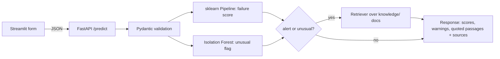

# Maintaina AI: Predictive Maintenance Copilot

Estimates machine failure risk from sensor readings, flags unusual readings, and retrieves relevant passages from **your own**
maintenance documents. **Decision support only**: not an autonomous controller and not a guarantee.

**Stack:** scikit-learn Pipeline (Random Forest + Isolation Forest) · FastAPI · Pydantic · TF-IDF retrieval (swappable for embeddings + FAISS) · Streamlit

## Architecture

Training (`maintaina/train.py`), inference (`maintaina/predict.py`), retrieval (`maintaina/rag.py`), API (`api/`) and UI (`app/`) are separate modules of one modular monolith.

## Run locally
```bash
pip install -r requirements-dev.txt
python -m maintaina.train            # downloads AI4I 2020 from UCI, trains, writes models/
uvicorn api.main:app --reload        # Swagger UI: http://127.0.0.1:8000/docs
streamlit run app/streamlit_app.py   # dashboard (trains automatically on first start if models/ is empty)
pytest -q
```

## Deploy
**Streamlit Community Cloud (easiest, one service):** push to GitHub → share.streamlit.io → New app → main file `app/streamlit_app.py`.
The first start downloads the dataset and trains (about a minute); it then runs in-process without the API.

**Render (API + dashboard):** New + → Blueprint → select this repo (uses `render.yaml`). After the API deploys, set `API_URL` on the dashboard
service to the API's URL. Free instances sleep when idle, so the first request can take around a minute. Check Render's current free-tier limits before relying on it.

## Knowledge base (RAG)
Add real manuals to `knowledge/` (see its README). Passages are retrieved and **quoted** with source and page; nothing is generated, and retrieved text is never
treated as instructions. If nothing relevant is found the app says so. Retrieval is TF-IDF cosine similarity; the minimum-similarity cutoff (`min_score`) should be tuned
with `evaluate_retrieval` on questions with known answers from your documents. To use embeddings, replace the vectorizer in `rag.py` with
`sentence-transformers` + `faiss-cpu` behind the same `search()` method (heavier: not recommended on 512 MB free instances).

## API
| Endpoint | Purpose |
|---|---|
| `GET /health` | Model and knowledge-base status |
| `GET /model-info` | Metadata: schema, threshold, test metrics, limitations |
| `POST /predict` | Validated reading → failure score, alert, anomaly flag, warnings, guidance |
| `POST /guidance` | Search the knowledge base directly |
| `POST /reindex` | Re-read `knowledge/` after adding documents |

Example: `curl -X POST localhost:8000/predict -H 'content-type: application/json' -d '{"type":"M","air_temperature":300,"process_temperature":310,"rotational_speed":1500,"torque":40,"tool_wear":100}'`

## Honest limitations
- AI4I 2020 is **synthetic**; scores here do not show real-factory performance. Rows are snapshots, not time series.
- Failure scores come from a Random Forest and are **not calibrated probabilities**. The alert threshold comes from an **assumed** 10:1 missed-failure vs false-alarm cost.
- An anomaly flag means "unusual", not "failing", and is not a probability.
- Test metrics are based on few failures and are noisy. Feature importance is not causation.
- The retrieval step only helps if you provide trustworthy documents.

Dataset: AI4I 2020 Predictive Maintenance Dataset, UCI ML Repository, DOI 10.24432/C5HS5C, CC BY 4.0.
